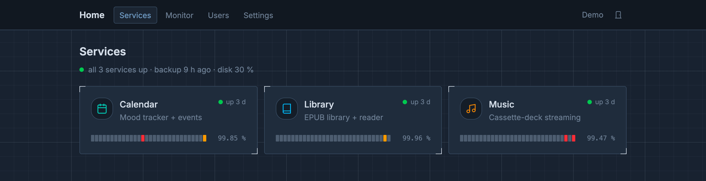
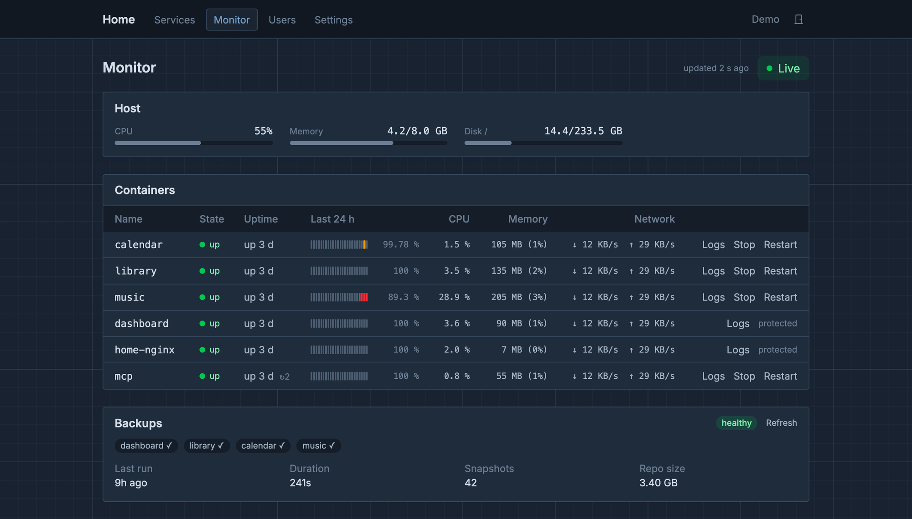
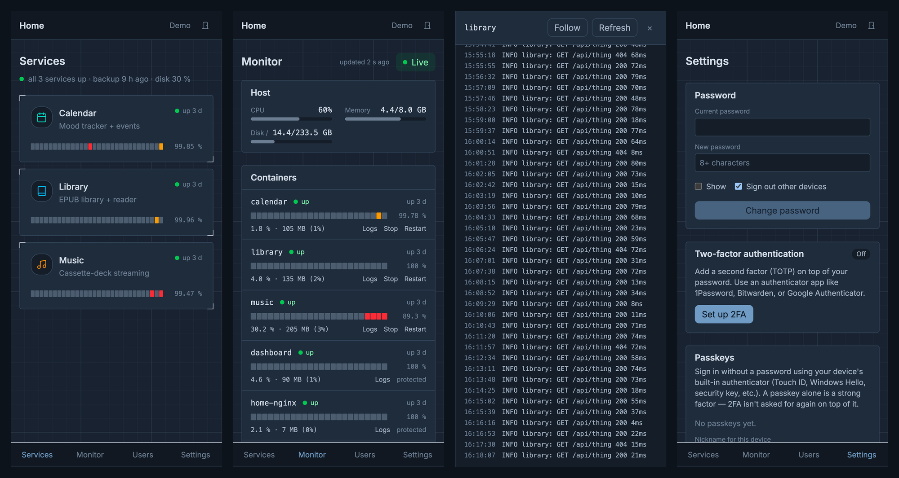

# Dashboard

The front door and control room of the home stack: one sign-in for Library, Calendar and Music, and one place to see whether everything is up, has stayed up, and was backed up last night.







## Features

- **Services**: a tile per app with its state (up, degraded, down) and a 30-day uptime strip, plus one status line saying whether anything needs you. Tiles open the app in a new tab; admins can start a down service or read its logs from the tile.
- **Monitor** (admins): host CPU, memory, disk and temperature; every container's uptime, restarts, 24-hour strip, CPU, memory and network; Start, Stop, Restart and a logs pane beside the page; the last backup. It shows when its data is stale.
- **Uptime history**: a sampler records each container once a minute (Docker's state plus its healthcheck) into hourly rows kept for 90 days.
- **One sign-in**: passwords (breach-checked), TOTP 2FA with recovery codes, passkeys, and API tokens for native apps. nginx asks the dashboard who you are before serving any app.
- **Your account**: change your password, see where you're signed in and sign other devices out, review recent sign-ins.
- **Users** (admins): add people, set passwords (which signs them out everywhere), change roles with Undo, reset 2FA.
- **AI assistants**: an MCP server in [`mcp/`](mcp/) lets any MCP client use the apps as the signed-in user.

## Run it

The whole stack, with nginx in front:

```sh
scripts/dev-certs.sh                                   # one-time TLS for home.local + localhost
docker compose up -d --build
docker compose exec dashboard python -m app.cli create-admin <username>
open https://localhost
```

Just the dashboard, for development:

```sh
uv sync
uv run python -m app.cli create-admin <username>
cd frontend && npm install && npm run dev              # API on :8000, UI on :5173
```

Tests: `uv run pytest`. Lint: `uvx ruff check .` and `npm run lint` in `frontend/`.

## Home stack

- **New apps**: push a repo with a `Dockerfile`, a `homestack.toml` and CI, then add it in the **Deploy** tab; the Pi clones, builds and routes it. See [`docs/APPS.md`](docs/APPS.md).
- **Services are discovered, not registered.** A container with `homehub.enable=true` and `homehub.route` labels (plus optional `name`, `icon`, `description`) becomes a tile; see the `labels:` blocks in `docker-compose.yml`.
- **Data**: the dashboard's database is `./data/dashboard.db`. The container runs as uid 10001, so after using the CLI on the host run `sudo chown -R 10001:10001 data/`.
- **Users**: apps create a user's account on their first visit. To create them up front, run `uv run python scripts/sync_household_users.py` after adding someone.
- **Docker access**: set `DOCKER_GID` to the GID of `/var/run/docker.sock` (Pi/Debian: usually 999).
- **Deploys**: commits to `master` that pass CI deploy to the Pi on their own; see [`docs/DEPLOY.md`](docs/DEPLOY.md).
- **Away from home**: the Pi is on Tailscale, so any device on the tailnet reaches the stack at the Pi's MagicDNS name (`https://<pi>.<tailnet>.ts.net`). The certificate is still the self-signed `home.local` one, so browsers warn until it's replaced (see the roadmap).
- **Backups**: a nightly restic backup of every app to Google Cloud Storage; the Monitor shows its last run. Setup and restores: [`docs/BACKUPS.md`](docs/BACKUPS.md).

## Settings

Copy [`.env.example`](.env.example) to `.env`; it also holds the other apps' settings.

| Variable | Does |
|---|---|
| `DATABASE_URL` | SQLite path (default `./data/dashboard.db`) or a Postgres URL |
| `SESSION_COOKIE_SECURE` | `1` once TLS is in front |
| `PROTECTED_CONTAINERS` | Containers the dashboard won't stop (default `dashboard,home-nginx`) |
| `DOCKER_GID` | GID of the Docker socket |
| `LOGIN_RATE_LIMIT` | Sign-in attempts per IP (default `5/minute`) |
| `BACKUP_STATUS_FILE`, `BACKUP_STALE_AFTER_HOURS` | Where the backup script writes its status, and when a backup counts as stale (default 36 h) |
| `UPTIME_SAMPLER` | `0` turns uptime sampling off |
| `WEBAUTHN_RP_ID`, `WEBAUTHN_ORIGIN` | Passkey domain and origin |

## Commands

```sh
uv run python -m app.cli create-admin <user> [--display-name "Name"]
uv run python -m app.cli create-user <user> [--admin]
uv run python -m app.cli passwd <user>
uv run python -m app.cli list-users
uv run python -m app.cli purge-sessions
```

Inside compose: `docker compose exec dashboard python -m app.cli <command>`.

## More

- [`docs/API.md`](docs/API.md): every endpoint, and how API tokens work.
- [`docs/DEPLOY.md`](docs/DEPLOY.md): the Pi's pull-based auto-deploy.
- [`docs/BACKUPS.md`](docs/BACKUPS.md): backups and restores.
- [`docs/ui-spec.md`](docs/ui-spec.md): the design system the four apps share.
- [`mcp/README.md`](mcp/README.md): the MCP server.
- [`docs/roadmap.md`](docs/roadmap.md): what's left to do.
